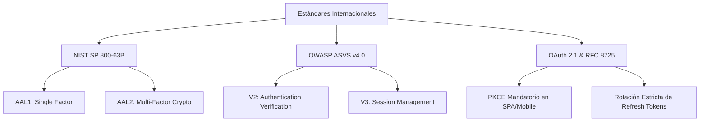
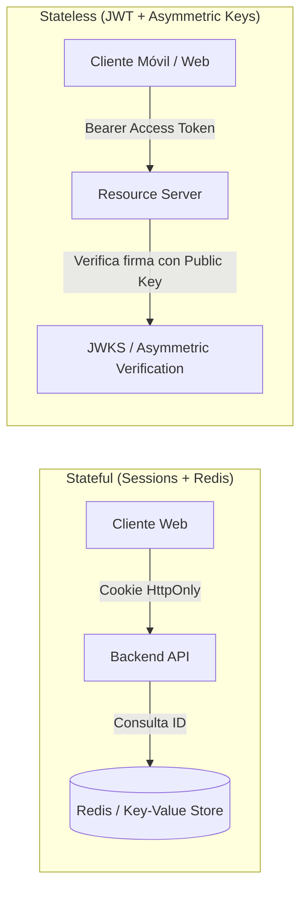
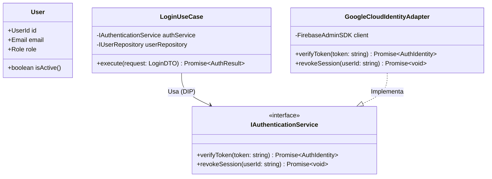

# Investigación Arquitectónica: Diseño e Implementación de Sistemas de Autenticación de Alta Seguridad (Web, Mobile y API)

> **Autor:** Antigravity Architect / Stellel  
> **Ámbito:** Global (Directrices corporativas y base para TucanGo)  
> **Fecha:** Noviembre 2026  
> **Clasificación:** Arquitectura de Software, Ciberseguridad & Gobernanza

---

## 1. Fundamentos y Normativas Internacionales de Ingeniería

El diseño de un subsistema de autenticación moderno debe regirse por normativas estandarizadas para garantizar confidencialidad, integridad, no repudio y trazabilidad.

### 1.1 NIST SP 800-63B (Digital Identity Guidelines)
El marco del National Institute of Standards and Technology establece los **Niveles de Aseguramiento de la Autenticación (AAL)**:
* **AAL1:** Autenticación de un solo factor (contraseña o token biométrico local).
* **AAL2:** Obligatoriedad de autenticación multifactor (MFA/2FA) utilizando dos factores diferentes (conocimiento, posesión, inherencia).
* **Directrices de Contraseñas NIST:**
  - Longitud mínima recomendada: 8 a 64 caracteres.
  - Prohibición de truncamiento de contraseñas.
  - Eliminación de reglas arbitrarias de composición de caracteres (ej. obligar a un carácter especial) a favor de longitud y verificación contra listas de contraseñas comprometidas (*Have I Been Pwned* / breach lists).
  - Eliminación de la caducidad periódica obligatoria sin causa fundada (fomenta patrones predecibles).

### 1.2 OWASP ASVS v4.0 (Application Security Verification Standard)
* **V2 - Autenticación:**
  - Protección contra ataques de fuerza bruta y credential stuffing con rate limiting e IP throttling.
  - Verificación en tiempo constante (*constant-time comparison*) para evitar ataques de canal lateral (*timing attacks*).
  - Almacenamiento con funciones de derivación de claves seguras (KDF con salt individual).
* **V3 - Gestión de Sesiones:**
  - Destrucción irrevocable de sesiones en logout (servidor y cliente).
  - Renovación de identificadores de sesión tras el inicio de sesión exitoso (evita *Session Fixation*).
  - Expiración de inactividad y tiempo de vida absoluto (*Absolute vs. Idle Timeout*).

### 1.3 OAuth 2.1 & OIDC (OpenID Connect)
* **OAuth 2.1 consolidado:** Depreca el flujo *Implicit Grant* y el *Resource Owner Password Credentials Grant*.
* **PKCE (Proof Key for Code Exchange - RFC 7636):** Mandatorio para todo cliente público (Single Page Applications en React/Vue, aplicaciones móviles en Flutter/React Native y clientes de escritorio).
* **OIDC:** Capa de identidad estandarizada sobre OAuth 2.0 que proporciona un `id_token` firmado criptográficamente (JWT) junto con el `access_token`.

---

## 2. Modelos Arquitectónicos: Stateful vs. Stateless

### Tabla Comparativa de Estrategias

| Parámetro | Stateful (Server-Side Session) | Stateless (Tokens JWT / OIDC) | Híbrido (JWT + Blacklist / Refresh Token) |
| :--- | :--- | :--- | :--- |
| **Mecanismo** | Session ID opaco en Cookie | Access Token autofirmado | Access Token corto + Refresh Token rotativo en DB |
| **Almacenamiento Cliente** | Cookie `HttpOnly; Secure; SameSite` | Memoria en runtime o Keystore | Cookie HttpOnly (Web) o Secure Keychain (Mobile) |
| **Escalabilidad** | Requiere cache distribuida (Redis) | Altamente escalable, zero I/O en DB | Escalable; solo valida I/O en renovación |
| **Revocación Inmediata** | Instantánea (eliminar de Redis) | Imposible hasta expiración del token | Instantánea al revocar el Refresh Token |
| **Idóneo para** | Monolitos y Web tradicional | Microservicios y APIs públicas | Aplicaciones Web modernas (SPA) y Móviles |

---

## 3. Almacenamiento Seguro por Plataforma

> [!CAUTION]
> **Vulnerabilidad Crítica:** Almacenar tokens de acceso o refresh tokens en `localStorage` o `sessionStorage` en aplicaciones web expone la sesión a robo total mediante cualquier vector de Cross-Site Scripting (XSS).

### 3.1 Clientes Web (Browsers)
1. **Access Token:** Mantener exclusivamente en memoria (JavaScript state / closure) o como cookie de corta duración.
2. **Refresh Token / Session Token:** Enviar en una Cookie con los atributos:
   - `HttpOnly`: Impide acceso desde scripts JavaScript.
   - `Secure`: Solo se transmite mediante conexiones HTTPS TLS 1.3.
   - `SameSite=Strict` o `SameSite=Lax`: Previene ataques de Cross-Site Request Forgery (CSRF).
   - `Path=/api/auth`: Restringe la cookie únicamente a los endpoints de autenticación y rotación.

### 3.2 Clientes Móviles (iOS / Android)
1. **iOS:** Apple Keychain Services (`kSecClassGenericPassword`), con acceso protegido por Secure Enclave.
2. **Android:** Android Keystore Provider junto con `EncryptedSharedPreferences` (Jetpack Security).

---

## 4. Hashing Criptográfico de Credenciales

Si se implementa autenticación local propia (usuario y contraseña):

1. **Argon2id (Estándar de Oro actual):**
   - Ganador del Password Hashing Competition (PHC).
   - Resistente a ataques basados en memoria (GPU/ASIC) y ataques de canal lateral.
   - Parámetros recomendados: `m=64MB, t=3, p=4`.
2. **bcrypt (Alternativa robusta tradicional):**
   - Cost factor mínimo: `12` o `13` (balance de 250ms a 500ms por verificación para frenar fuerza bruta).
3. **Pbkdf2 / scrypt:** Alternativas aceptadas por normativas gubernamentales si Argon2 no está homologado en la plataforma.

---

## 5. Diseño e Integración con Clean Architecture en TucanGo

TucanGo está estructurado con TypeScript, Orientación a Objetos y Clean Architecture. El subsistema de autenticación debe modelarse desacoplando la regla de negocio del proveedor de identidad.

### Organización por Capas:
1. **Domain Layer:**
   - Entidad: `User`, `AuthIdentity`.
   - Value Objects: `Email`, `UserId`, `JwtToken`.
2. **Application Layer (Use Cases):**
   - `AuthenticateUserUseCase`: Orquesta la validación de la identidad y mapea permisos en el sistema.
   - `AuthorizeRoleUseCase`: Aplica el patrón Specification o RBAC para autorizaciones.
3. **Infrastructure Layer (Adapters):**
   - `GoogleCloudIdentityAdapter` o `FirebaseAuthAdapter`: Implementa el puerto `IAuthenticationService`. Utiliza las claves públicas de Google para validar los JWTs sin acoplar el núcleo de negocio.
4. **Presentation Layer:**
   - Middleware de Express / Fastify / HTTP nativo: Extrae el encabezado `Authorization: Bearer <token>` o la cookie de sesión, ejecuta el caso de uso y adjunta el `UserContext` al Request.

---

## 6. Opciones de Implementación: Evaluación de Proveedores

Para el ecosistema Stellel y específicamente para **TucanGo**, se analizan 3 alternativas técnicas:

### Alternativa 1: Google Cloud Identity Platform / Firebase Auth (⭐ RECOMENDADA)
Aprovechando que ya contás con consola en **Google Cloud Platform (GCP)**:
* **Costo:** Gratuito hasta 50.000 usuarios activos mensuales (MAU). Cero costo de infraestructura de contraseñas.
* **Seguridad Integrada:**
  - Certificaciones SOC 1/2/3, ISO/IEC 27001, HIPAA compliant.
  - Soporte nativo para OAuth 2.0 (Google, GitHub, Microsoft) y Email/Password con protección contra ataques de fuerza bruta.
  - SDKs oficiales cliente para Web (TypeScript) y Móvil (Flutter / React Native).
  - Verificación en backend simple y sin llamadas de red obligatorias (validación asimétrica local de firmas RSA con claves públicas de Google cacheadas).
* **Impacto en TucanGo:** El backend solo necesita el adaptador `IAuthenticationService` usando `firebase-admin` o `google-auth-library`.

### Alternativa 2: Servidor de Autenticación Self-Hosted (Dokploy + Redis + Postgres)
* **Ventajas:** Soberanía total de datos en tu servidor propio (Asus homelab).
* **Desventajas:** Mayor carga operativa: tu equipo debe implementar manualmente el hashing con Argon2id, rotación de tokens, invalidación en Redis, mitigación de rate-limiting (fail2ban/Caddy), y recuperación de contraseñas vía SMTP.

### Alternativa 3: Supabase Auth / Clerk / Auth0
* **Ventajas:** Rápida integración mediante paneles web.
* **Desventajas:** Dependencia de proveedores terceros adicionales fuera del entorno GCP ya configurado.

---

## 7. Plan de Acción y Recomendación Final para TucanGo

1. **Aprovechar Google Cloud Identity Platform / Firebase Authentication:**
   - Proporciona la solución más profesional, escalable y conforme a estándares para una entrega de nivel universitario de ingeniería de software.
2. **Definir el Contrato de Dominio en `tucango-web`:**
   - Declarar `IAuthenticationProvider` en el puerto de aplicación.
3. **Despliegue de credenciales seguras vía Bitwarden Secrets Manager (BSM):**
   - Centralizar las credenciales de servicio de Google Cloud (`service-account.json`) en BSM e inyectarlas al contenedor Docker en Dokploy.
