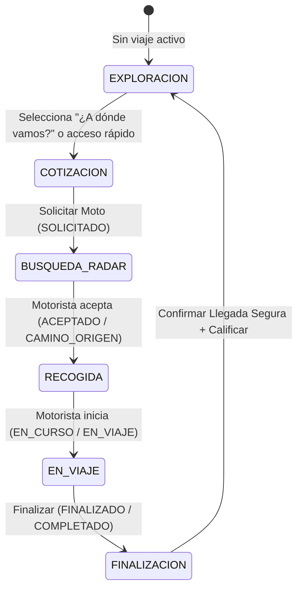

# Investigación Técnica y Arquitectura de Adaptación: DiDi (Rider / Moto / Driver) aplicado a TucanGo

> **Propósito:** Documentar la arquitectura UI/UX, mecánicas de negocio, ingeniería de seguimiento GPS en tiempo real y arquitectura de mapas de **DiDi** (con énfasis en **DiDi Moto** y **DiDi Conductor**) para evolucionar **TucanGo** (movilidad estudiantil segura en motocicleta para la Universidad de la Amazonia, Florencia, Caquetá) sobre su código en `tucango-web/` (TypeScript/Node 22 + SQLite WAL + SSE + Leaflet).

---

## 0. Diagnóstico Base vs. Arquitectura Objetivo DiDi Moto / Driver

| Capacidad | Base previa en `tucango-web/` | Evolución DiDi Moto / Driver en TucanGo |
| :--- | :--- | :--- |
| **Layout y Mapa (`public/`)** | Grid 2 columnas (`1.35fr / 1fr`) con mapa acotado de `410px`. | Lienzo mapa-céntrico (`100dvh` en móvil / sticky amplio en escritorio) + *Bottom Sheet* redondeado (`24px`) con cinta superior de seguridad. |
| **Autenticación y Roles** | Tabs abiertos (`Pasajero` / `Motorista`) con `<select>` manual. | Login rápido con 1 clic o credencial (`POST /api/auth/login`) por cédula, código estudiantil, placa o correo institucional, con badge de sesión activa. |
| **Disponibilidad y Flota** | `Motorista` con `Moto` + `soatVigente` obligatorio. | Switch `En línea · Recibiendo pedidos` (`POST /api/motoristas/disponibilidad`) y bloqueo de desconexión durante viajes activos. |
| **Tracking GPS y Rumbo** | Polilínea recta de 2 puntos sin rotación ni progreso. | Coordenadas GPS y rumbo (`direccionGrados` `0..359`), interpolación por etapas (`CAMINO_ORIGEN` y `EN_VIAJE`), PIN de seguridad de 4 dígitos, eventos SSE de tracking y marcadores SVG cenitales rotatorios. |
| **Proveedor de Mapas** | Tiles OSM directos en frontend sin configuración centralizada. | Endpoint `/api/mapa/config` con adaptador híbrido (`Carto Voyager + OSRM` con fallback determinista en backend) y soporte configurable para Google Maps Platform (`GOOGLE_MAPS_API_KEY`). |

> **Encuadre normativo TucanGo (`Docs/notebooklm/03_Marco_Legal_Normativo_y_Etico.md`):** Bajo la autonomía universitaria (Ley 30 de 1992), TucanGo se posiciona como plataforma académica de registro comunitario, verificación documental de seguridad (SOAT vigente, identificación institucional, PIN de abordaje) y trazabilidad de llegada segura intra-campus.

---

## 1. Arquitectura UI/UX estilo DiDi (Bottom Sheet + Mapa-Céntrico)

### 1.1 Jerarquía espacial de capas (*Map-First Layering*)

En DiDi Rider, DiDi Moto y DiDi Driver, el mapa es el **lienzo continuo** sobre el que flotan controles con `z-index` jerarquizados y `pointer-events` selectivos:

```text
+-----------------------------------------------------------------------+
| Layer 3 (z: 1500): Modales críticos (Login, Registro, Calificación)   |
+-----------------------------------------------------------------------+
| Layer 2 (z: 700):  Bottom Sheet interactivo + Cinta de Seguridad      |
+-----------------------------------------------------------------------+
| Layer 1 (z: 600):  Controles flotantes mapa (Menú ☰, Motor Mapas,     |
|                    Botón Escudo, Pill Ruta, Diana GPS ⌖, Simulador)   |
+-----------------------------------------------------------------------+
| Layer 0 (z: 1):    Mapa interactivo + Polilíneas + Punto GPS azul +   |
|                    Marcadores SVG cenitales de motocicleta rotatorios |
+-----------------------------------------------------------------------+
```

Reglas de diseño y ergonomía aplicadas al sistema Uniamazonia:
- **Paleta institucional + acentos DiDi Moto:** Superficies claras `#FFFFFF`, fondo neutro `#F4F5F7`, identidad institucional Uniamazonia `#0F6B36`, cinta de confianza en azul seguridad (`#4B8EF7` -> `#2D6FE4`) y CTA operativo moto `#FF6600`.
- **Responsive Mobile-First (`< 960px`):** El mapa ocupa la mitad superior (`46dvh`) y el Bottom Sheet superpuesto (`border-radius: 24px 24px 0 0`) emerge inmediatamente debajo con manija (*handle*) visual. En escritorio (`>= 960px`), el mapa permanece sticky a la izquierda y el sheet opera como *dock* dedicado a la derecha.

### 1.2 Cinta superior de seguridad ("Detección continua, más protección")

Ubicada en el borde superior del Bottom Sheet con ícono de escudo y texto de alto contraste:
- Comunica protección activa permanente (`Detección continua, más protección · Protocolo SOAT y PIN Uniamazonia`).
- Durante un viaje activo se complementa con la tarjeta de seguimiento que muestra el **PIN de 4 dígitos** y la placa amarilla reglamentaria colombiana de motocicleta.

### 1.3 Home del Pasajero y Estados del Bottom Sheet

1. **Buscador principal `"¿A dónde vamos?"`:** Barra destacada con lupa y chip `MOTO`, resumen de ruta activa y acceso directo al seleccionador origen/destino.
2. **Banner inteligente:** `"Deja que Tarifa Inteligente optimice tu viaje >"` para seleccionar la tarifa óptima universitaria.
3. **Accesos rápidos horizontales (Pills):** `La Vega`, `Porvenir`, `Centro`, `Balcanes`, `Cuenta`.
4. **Historial reciente con ícono de reloj:** Rutas frecuentes en Florencia (`Terminal de Transportes`, `Plaza Pizarro`).
5. **Tarjetas promocionales comunitarias:** Beneficios de movilidad estudiantil segura (tarifa plana campus `$2.500 COP`, casco certificado y protocolo SOAT + PIN).

Máquina de estados visual sincronizada 1:1 con `EstadoViaje` y `EtapaTracking`:



### 1.4 Diseño específico para Motorista (DiDi Moto HUD)

Pensado para lectura rápida (*glanceability*) en manubrio:
- **Switch `En línea / Desconectado`** conectado a `POST /api/motoristas/disponibilidad`, junto con readout de coordenadas GPS y rumbo actual.
- **Tarjeta de pedido entrante en radar:** Muestra código, PIN, origen -> destino, tarifa neta, método de pago y botón `Aceptar Pedido`.
- **Tarjeta de viaje activo:** Muestra etapa (`Rumbo al origen` vs `Viaje en curso`), barra de progreso `0..100%`, **PIN del pasajero**, botón de avance/simulación GPS (`📍 Avanzar / Simular Recorrido GPS`), `Iniciar Trayecto` y `Finalizar y Cobrar`.

---

## 2. Mecánicas de Emparejamiento (Dispatch), Tarifas y Login

- **Login Rápido y Roles (`POST /api/auth/login`):** Resuelve estudiantes (por cédula, código estudiantil, teléfono o correo `@uniamazonia.edu.co`) y motoristas (por cédula, placa de moto o correo). En producción con usuarios reales se recomienda evolucionar a tokens firmados (`HMAC-SHA256` o JWT) y exigir validación del PIN en `POST /api/viajes/iniciar` con PIN generado aleatoriamente vía `crypto.randomInt(1000, 10000)`.
- **Tarifas (`Strategy Pattern`):** Soporta `TarifaEstudiantilFija`, `TarifaPorKilometro`, `TarifaDinamicaLluvia` y `TarifaNocturna`; extensible directamente hacia `TarifaNegociada` ("Pon tu precio" con bandas piso/techo reguladas) y `TarifaInteligente`.
- **Guardrails de seguridad:** Bloqueo de registro/operación sin `SOAT` vigente, prohibición de desconexión con viaje en curso y prohibición de cancelar un trayecto ya iniciado en `EN_CURSO`.

---

## 3. Ingeniería de Seguimiento GPS en Tiempo Real

### 3.1 Flujo de telemetría (Backend -> SSE -> Leaflet)

1. El motorista (o simulador `POST /api/viajes/tracking`) reporta coordenadas `(lat, lng)` y rumbo en grados (`0..359`).
2. `Motorista.actualizarUbicacion()` calcula el **Forward Bearing** automático cuando no se provee rumbo explícito:
   $$\text{bearing}^\circ = \left(\frac{\operatorname{atan2}(\sin\Delta\lambda\cos\varphi_2,\ \cos\varphi_1\sin\varphi_2 - \sin\varphi_1\cos\varphi_2\cos\Delta\lambda)\cdot 180}{\pi} + 360\right) \bmod 360$$
3. El backend emite `TRACKING_VIAJE_ACTUALIZADO` / `UBICACION_MOTORISTA_ACTUALIZADA` vía `EventBus -> SSE (/api/eventos)`.
4. El cliente actualiza el marcador SVG cenital de la motocicleta usando **transición CSS suave** y **desenrollado del ángulo más corto** (*shortest-angle unwrapping*) en $[-180^\circ, +180^\circ]$ para evitar giros completos indeseados al cruzar `0°/360°`.

### 3.2 Interpolación de rutas y evolución recomendada

- **Etapa `ACEPTADO` (`CAMINO_ORIGEN`):** Interpola desde la ubicación actual del motorista hacia las coordenadas del sector de recogida usando la fracción de avance restante.
- **Etapa `EN_CURSO` (`EN_VIAJE`):** Interpola a lo largo de la polilínea entre origen y destino.
- **Mejora recomendada a mediano plazo:** Migrar de interpolación por índice uniforme de vértice a **parametrización por longitud de arco (`arc-length`)** sobre geometrías densas de OSRM/Google Routes y separar en `app.js` el listener SSE de tracking para actualizar únicamente el marcador/barra sin recargar `/api/estado` completo en frecuencias `< 1s`.

---

## 4. APIs de Mapas: Google Maps Platform vs. Stack Híbrido Gratuito

### 4.1 APIs de Google Maps Platform requeridas para paridad total

Para operar 100% sobre Google Cloud Platform (requiere **Billing Account** vinculada; desde marzo de 2025 ofrece cuotas gratuitas por SKU — *Essentials / Pro / Enterprise*):
1. **Maps JavaScript API** (restringida por HTTP Referrer en frontend): lienzo vectorial, marcadores avanzados y cámara.
2. **Routes API** *(sucesor de Directions + Distance Matrix APIs)* (key en backend proxy): cálculo calle-por-calle, soporte `TWO_WHEELER`, ETA con tráfico y matriz $N \times M$ para dispatch.
3. **Places API (New):** autocompletado en `"¿A dónde vamos?"` usando **Session Tokens** y `FieldMask` mínimo.
4. **Roads API (`Snap to Roads`):** ajuste de trazas GPS móviles ruidosas a las vías reales.

### 4.2 Stack Híbrido Gratuito de TucanGo (Sin bloqueos de facturación)

Para operación inmediata a costo `$0 USD` en Florencia y despliegue continuo en **Dokploy**:
- **Capa cartográfica visual:** **Carto Voyager** (`https://{s}.basemaps.cartocdn.com/rastertiles/voyager/{z}/{x}/{y}{r}.png`, paleta clara estilo DiDi) con fallback automático a **OpenStreetMap Standard** ante eventos `tileerror` (nota: para altos volúmenes o sin marca de agua CARTO en producción se puede configurar `CARTO_API_KEY` gratuita o migrar a **MapLibre GL + OpenFreeMap**).
- **Enrutamiento por calles reales:** Consulta al API de **OSRM** (`router.project-osrm.org/route/v1/driving`) con timeout corto (`2.4 s`) y **respaldo determinista en backend** (`TucanGoFacade.construirPolilinea()` en `GET /api/ruta`), garantizando que la aplicación jamás se bloquee offline ni ante límites de OSRM.
- **Activación progresiva (`GET /api/mapa/config`):** Si se define `GOOGLE_MAPS_API_KEY` en el entorno del servidor, el contrato `/api/mapa/config` expone el estado de integración para evolucionar sin modificar la arquitectura de dominio ni de tracking.
