# 🎓 Taller Práctico de Git y GitHub — Ingeniería de Sistemas (Universidad de la Amazonia)

> **Transferencia de Conocimiento e Impacto Comunitario**  
> **Expositor:** Equipo TucanGo  
> **Audiencia:** Estudiantes de Ingeniería de Sistemas — Universidad de la Amazonia  
> **Caso de Estudio:** Repositorio Oficial TucanGo  

---

## 📌 1. Presentación y Acceso a Diapositivas

Para facilitar el estudio y visualización del material sin requerir Microsoft PowerPoint instalado:

- 📄 **[Visualizar Diapositivas en PDF (Visor Integrado de GitHub)](Git_and_GitHub_Architecture.pdf)**
- 💻 **[Descargar Presentación Original Editable (.pptx)](Git_and_GitHub_Architecture.pptx)**

---

## 🎯 2. Propósito y Temas Dictados

La sesión se enfocó en enseñar **fundamentos conceptuales y flujo profesional** tomando como ejemplo vivo la arquitectura y evolución de TucanGo:

1. **Fundamentos Conceptuales de Git:**
   - ¿Qué es y qué no es Git? Diferencia entre motor distribuido (Git) y plataforma de colaboración (GitHub).
   - Estructura interna: blobs, trees, commits, punteros (`HEAD`, branches, tags).
   - El ciclo de los 3 estados: *Working Directory*, *Staging Area* y *Local Repository*.

2. **Flujo de Trabajo y Buenas Prácticas:**
   - Convención de ramas semánticas (`feature/`, `fix/`, `docs/`, `refactor/`).
   - Anatomía de un commit atómico y estándar de **Conventional Commits**.
   - Estrategias de integración y resolución metódica de conflictos (*merge conflicts*).

3. **Colaboración Profesional en GitHub:**
   - Flujo de Pull Requests (PR) y dinámicas de revisión de código (*Code Review*).
   - Automatización y buenas prácticas de higiene en repositorios (.gitignore, exclusión de binarios pesados).

---

## 🖼️ 3. Galería de Diapositivas del Taller

A continuación se presenta la secuencia visual de la clase:

### Diapositiva 01

  

---

### Diapositiva 02

  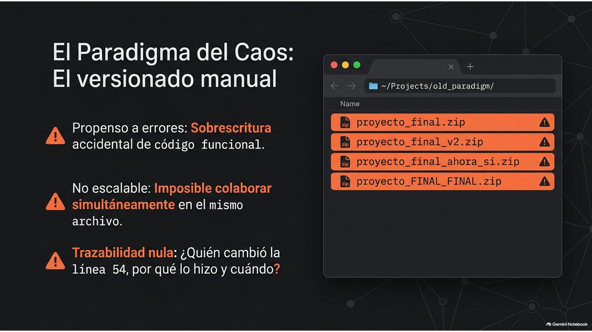

---

### Diapositiva 03

  

---

### Diapositiva 04

  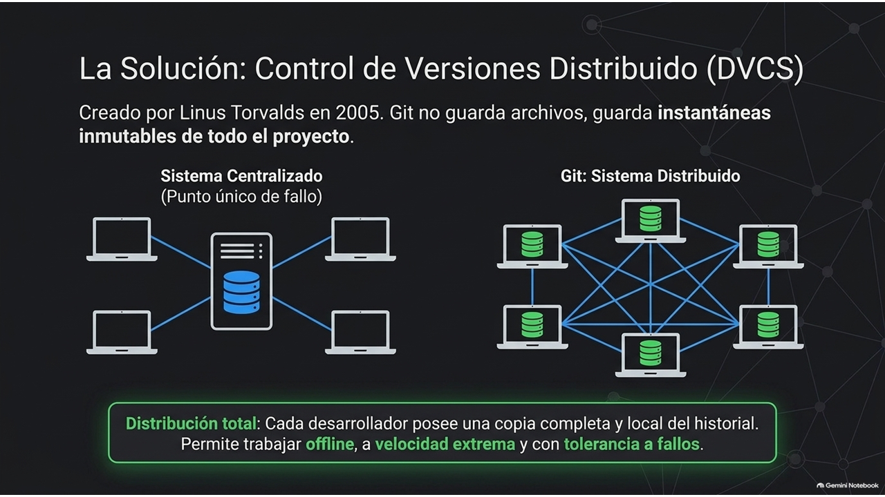

---

### Diapositiva 05

  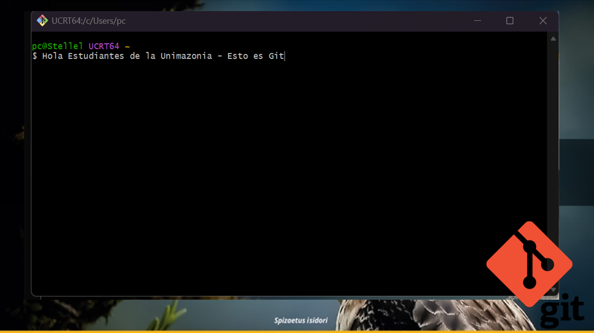

---

### Diapositiva 06

  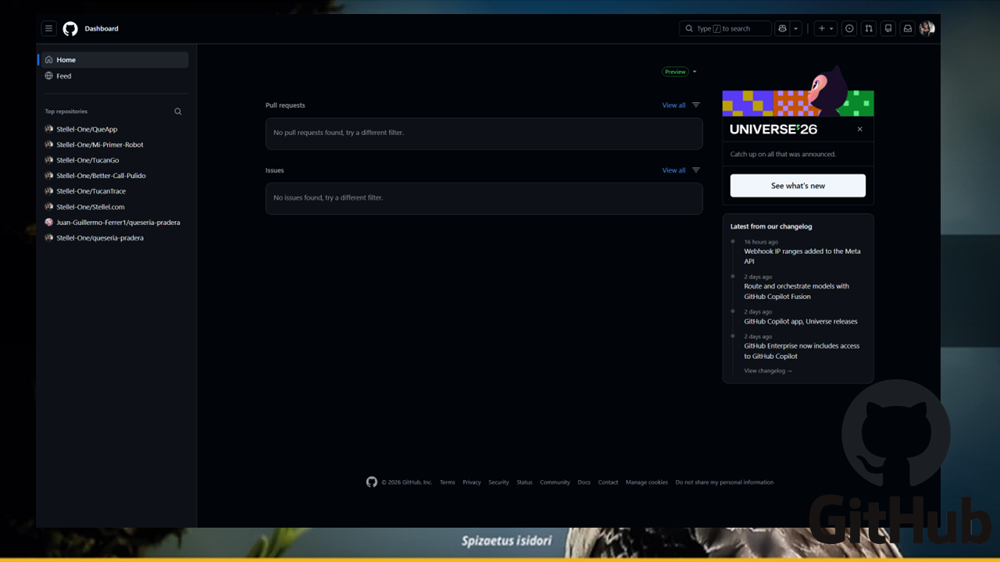

---

### Diapositiva 07

  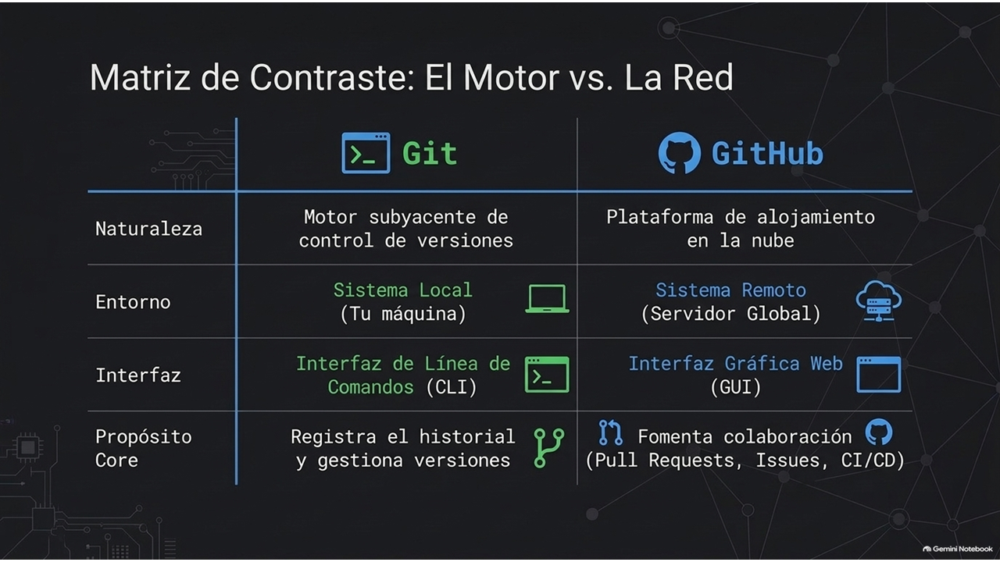

---

### Diapositiva 08

  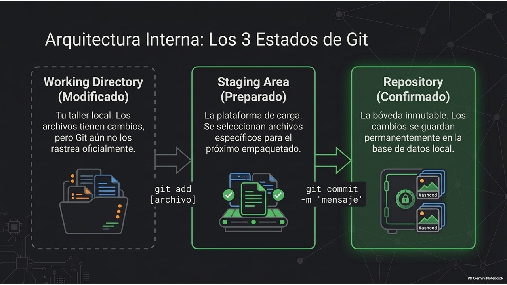

---

### Diapositiva 09

  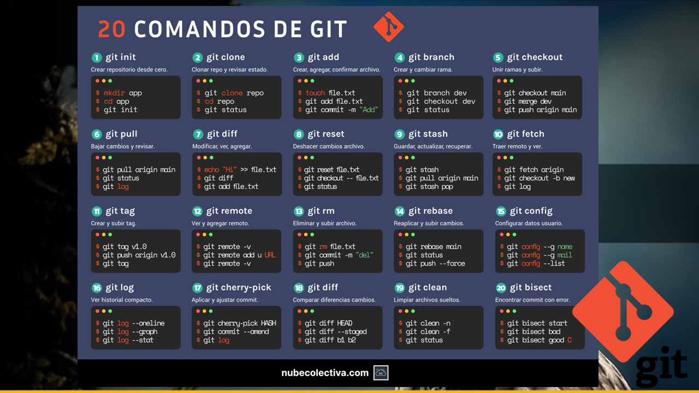

---

### Diapositiva 10

  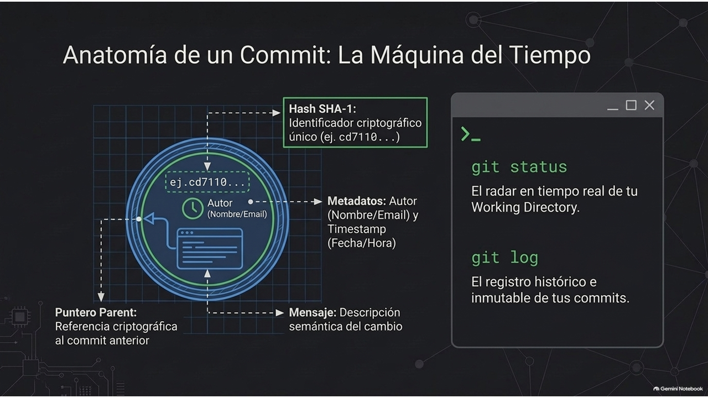

---

### Diapositiva 11

  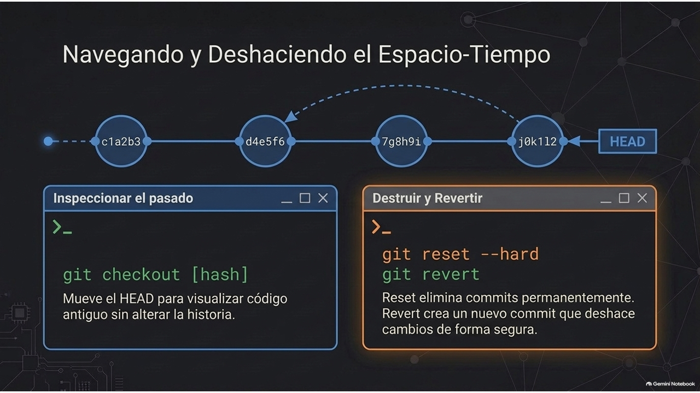

---

### Diapositiva 12

  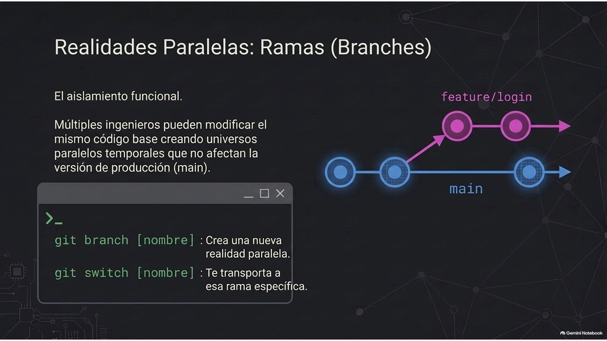

---

### Diapositiva 13

  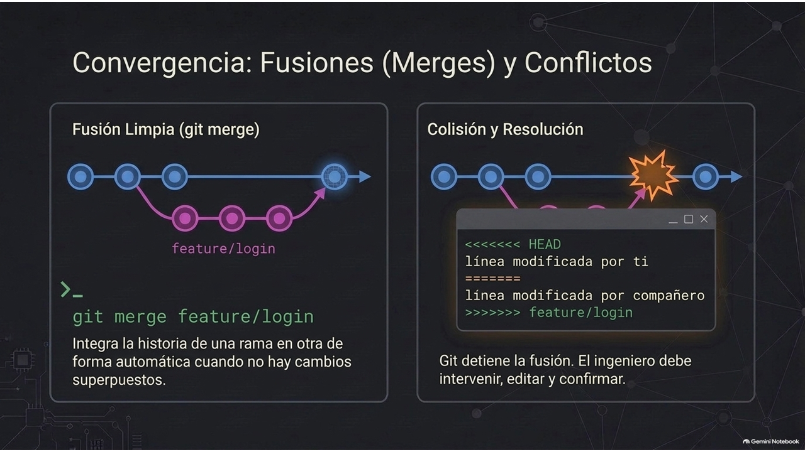

---

### Diapositiva 14

  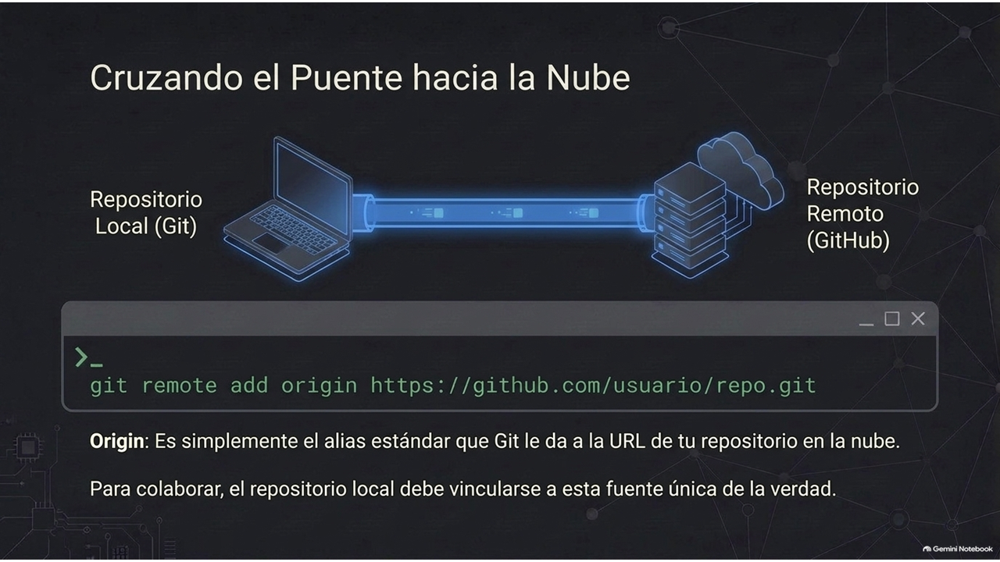

---

### Diapositiva 15

  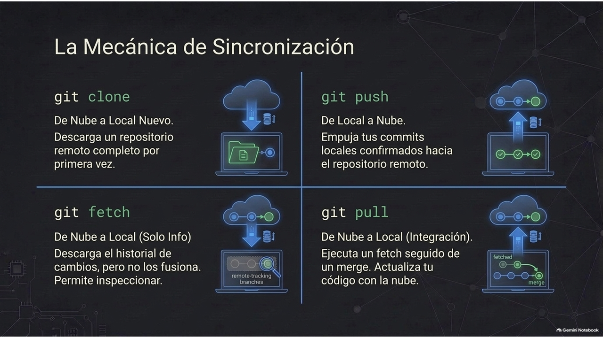

---

### Diapositiva 16

  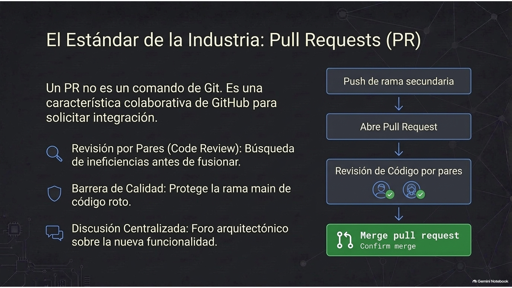

---

### Diapositiva 17

  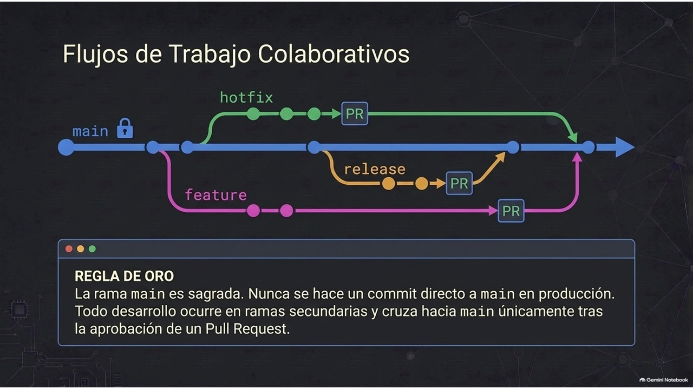

---

### Diapositiva 18

  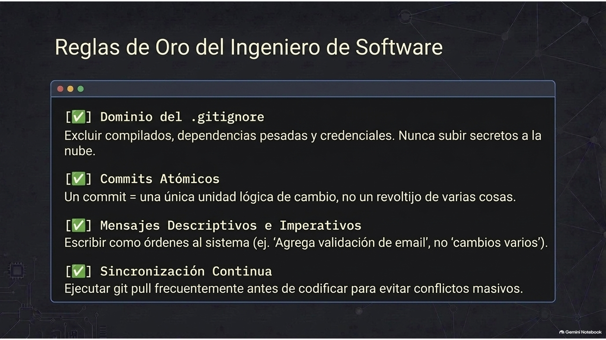

---

### Diapositiva 19

  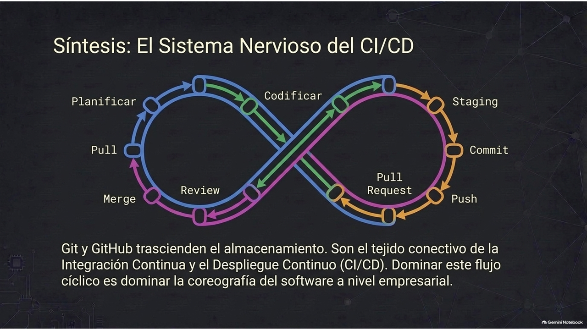

---

